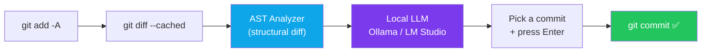

<div align="center">

# 🤖 git-agent-local

**Zero-API. 100% offline. AST-aware AI agent for your Git workflow.**

[](#)
[](LICENSE)
[](https://ollama.com)
[](#)
[](https://nodejs.org)
[](https://www.npmjs.com/package/git-agent-local)

*Your code never leaves your machine. Your API bill stays at $0.*

</div>

---

## ✨ What is this?

`git-agent-local` is a terminal agent that writes commit messages, PR
descriptions, and change explanations using an LLM **running entirely on your
own computer** (Ollama / LM Studio). No OpenAI key. No Claude key. No telemetry.

It doesn't just feed raw text diffs to a model. It **parses your diff into an
abstract syntax tree**, detects structural changes — functions added/removed,
signatures altered, exports changed, endpoints touched — and marks breaking
changes *before* the model ever sees them. The result: dramatically more
precise commit messages from even small local models.

## 🔄 The 10-second pipeline



```
 ┌──────────┐   ┌──────────────┐   ┌────────────────┐   ┌──────────────┐
 │ git diff │──▶│ AST / syntax │──▶│ local LLM      │──▶│ pick & commit│
 │ --cached │   │ tree analysis│   │ (localhost:11434)│   │  in 1 keystroke│
 └──────────┘   └──────────────┘   └────────────────┘   └──────────────┘
      your machine ——————————————————— nothing leaves ———————————————————
```

## 🚀 Quickstart (10 seconds)

```bash
# 1. install (needs Node >= 18 and Ollama running)
npm install -g git-agent-local

# 2. pull a coding model once (if you haven't already)
ollama pull qwen2.5-coder:7b

# 3. inside any git repo with staged changes
git add -A
git-agent commit
```

That's it. Arrow-keys to pick a commit message, hit Enter, done.

## 🎬 Every command

| Command | What it does | Needs LLM? |
|---|---|---|
| `git-agent commit` | Generate & pick a commit message, then commit | ✅ |
| `git-agent scan` | AST-analyze your diff: structural + breaking changes | ❌ |
| `git-agent explain` | Explain what your staged change actually does | ✅ |
| `git-agent pr` | Draft a full PR title / summary / test plan | ✅ |
| `git-agent doctor` | Diagnose git + Ollama + model setup | ❌ |
| `git-agent config show \| set` | Layered config: defaults → user → project → flags | ❌ |

Handy flags: `--yes` (print top candidate, no prompts), `--no-commit` (just
print the message), `--json` (machine-readable), `--model` / `--url`
(override model or endpoint), `--ref main` (diff against a branch).

## 🏆 Key features

- **🔓 100% offline & free** — talks only to `localhost`. Zero API keys, zero
  cost, zero telemetry. Airgap-friendly by design.
- **🌳 AST-aware analysis** — real `@babel/parser` syntax trees for JS/TS
  (plus language-aware scanners for Python, Go, Rust, Java, C/C++). Detects
  function/class/export additions, removals, and **signature changes**.
- **💥 Breaking-change detection** — a changed function signature or removed
  export is flagged `BREAKING` *before* commit, and the model is instructed
  to use `type(scope)!: ...` + a `BREAKING CHANGE:` footer.
- **🎯 Structured prompting** — small models get rigid JSON schemas instead
  of open-ended questions, so a 7B model behaves like a much bigger one.
- **⚡ Streaming + fast** — token-by-token streaming, automatic model fallback
  (`llama3.1 → qwen2.5-coder → deepseek-coder → codellama → llama3`).
- **🧭 Conventional Commits by default** — with your repo's recent commit
  style injected as few-shot context.
- **🧵 LM Studio friendly** — point it anywhere: `git-agent --url http://localhost:1234/v1`… just set `OLLAMA_HOST`.
- **🩺 `doctor` command** — one command to debug your whole local stack.
- **📦 Single-command install** — `npm i -g git-agent-local`. No native
  compilation, no Python, no Docker.

## ⚙️ Configuration

Layered: defaults → `~/.config/git-agent-local/config.json` →
`<repo>/.git-agent-local.json` → CLI flags → env (`OLLAMA_HOST`,
`GIT_AGENT_MODEL`).

```bash
# use a different model forever
git-agent config set model qwen2.5-coder:7b

# project-level: cat > .git-agent-local.json
{ "model": "deepseek-coder-v2", "conventionalCommits": true }
```

## 🩹 Troubleshooting

```text
✖ Cannot reach http://127.0.0.1:11434
  → ollama serve

✖ None of the preferred models are installed locally
  → ollama pull qwen2.5-coder:7b        # or llama3.1, codellama, …

✖ Not a git repository
  → cd into a repo, or: git init

✖ No diff found to analyze
  → git add -A   # stage something first
```

Run `git-agent doctor` — it checks git, the Ollama server, installed models,
and your effective config in one shot.

## 🗺️ Roadmap

- [ ] Interactive `git-agent review` — offline hunk-by-hunk review assistant
- [ ] Tree-sitter grammars for 10+ languages (WASM, still zero native deps)
- [ ] `git-agent squash` — suggest grouped commits for a messy branch
- [ ] Slash-command hooks for shell history / PR templates
- [ ] Windows winget + Homebrew tap distribution

## 🤝 Contributing

PRs welcome! Start here:

```bash
git clone https://github.com/your-org/git-agent-local
cd git-agent-local && npm install && npm run build
npm link          # puts `git-agent` on your PATH
git-agent doctor  # verify your setup
```

**🏷️ Good first issues** (look for this label on the tracker):

1. Add Tree-sitter WASM parsing for a new language (Ruby, PHP, Kotlin…)
2. Add a `--dry-run` flag to `commit`
3. Improve the risk-score formula with per-language weights
4. Add snapshot tests for `parseUnifiedDiff` against real-world patches
5. Docs: translate the README quickstart to your language
6. Support `.gitagentrc` YAML config in addition to JSON

See [CONTRIBUTING.md](CONTRIBUTING.md) for the full workflow. All
contributors must follow the [Code of Conduct](CODE_OF_CONDUCT.md).

## 📄 License

[MIT](LICENSE) — do whatever you like, attribution appreciated.

---

<div align="center">

**⭐ Star the repo if it saved you from writing another commit message.**

Report bugs · Request features · [Discussions](https://github.com/your-org/git-agent-local/discussions)

</div>
